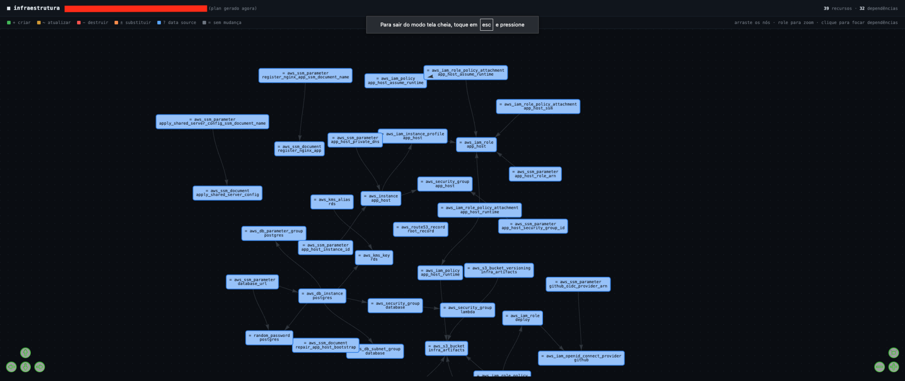

# tfgraph

CLI em Rust que gera (ou lê) um `plan` do **OpenTofu** ou **Terraform** e
abre no navegador um diagrama interativo de toda a infraestrutura
provisionada: cada recurso com seu nome, e as setas mostrando quem depende
de quem.



> A imagem mostra um exemplo de infraestrutura AWS. Os nomes exibidos são
> apenas ilustrativos e não fazem parte do projeto.

## Build

```bash
cargo build --release
# binário em target/release/tfgraph
```

## Instalação

Com Rust instalado, compile e instale o binário localmente:

```bash
cargo install --path .
```

O `tfgraph` precisa de `tofu` ou `terraform` disponível no `PATH` para o modo
automático. Também pode ler um JSON exportado ou um plan binário já existente.

## Uso — modo automático (o mais comum)

Rode dentro (ou apontando para) o diretório do seu projeto. O tfgraph
mesmo executa `tofu plan` + `tofu show -json` e abre o diagrama:

```bash
cd meu-projeto-opentofu/
tfgraph
```

ou apontando o diretório de fora:

```bash
tfgraph --dir ./infra/producao
```

Para passar variáveis/flags extras pro `plan`, use `--` no final:

```bash
tfgraph --dir ./infra -- -var-file=prod.tfvars
```

Por padrão o tfgraph detecta automaticamente `tofu` no PATH; se só tiver
`terraform` instalado, usa `terraform`. Pra forçar um dos dois:

```bash
tfgraph --cli tofu
tfgraph --cli terraform
```

## Uso — a partir de um plan já existente

Se você já gerou o plan por fora, pode apontar direto pra ele — tanto o
JSON quanto o binário:

```bash
tofu plan -out=plan.tfplan
tofu show -json plan.tfplan > plan.json

tfgraph --plan plan.json
# ou direto no binário (o tfgraph chama `tofu show -json` sozinho):
tfgraph --plan plan.tfplan
```

### Opções

| Flag | Descrição |
|---|---|
| `-d, --dir <diretório>` | projeto onde rodar `plan` + `show -json` (padrão: `.`) |
| `-p, --plan <arquivo>` | usa um plan/JSON já existente em vez de gerar um novo (ignora `--dir`) |
| `--cli <tofu\|terraform>` | força qual CLI usar (padrão: autodetecta, preferindo `tofu`) |
| `-o, --output <arquivo.html>` | onde salvar o HTML (padrão: arquivo temporário) |
| `--no-open` | só gera o HTML, não abre o navegador |
| `--title <texto>` | título mostrado no topo da página |
| `-- <args...>` | argumentos extras repassados pro `<cli> plan` (ex: `-var-file=`) |

### Privacidade

Plans de Terraform/OpenTofu podem conter valores sensíveis. O tfgraph exibe
nomes de recursos e dependências, mas trate os arquivos de plan e o HTML
gerado como dados privados e não os publique sem revisar o conteúdo.

## O que o diagrama mostra

- **Nós** = recursos (`aws_instance.web`, `aws_vpc.main`, data sources, etc.),
  coloridos igual à saída do `plan` no terminal: verde = criar, amarelo =
  atualizar, vermelho = destruir, laranja = substituir, cinza = sem mudança.
- **Setas** = dependências, tanto `depends_on` explícito quanto referências
  implícitas (`aws_instance.web` que usa `aws_vpc.main.id` vira uma seta
  `web -> main`).
- Clique num nó para destacar só ele e suas dependências diretas; arraste
  para reorganizar; role o mouse pra zoom.

OpenTofu é um fork compatível do Terraform e usa exatamente o mesmo schema
de JSON no `show -json`, então a extração de recursos/dependências
(`graph.rs`) funciona igual para os dois — só a chamada de binário externo
muda (`tofu` vs `terraform`), e isso é resolvido em `plan.rs`.

## Limitações conhecidas

- Saídas de módulo (`module.x.output`) não são resolvidas até o recurso
  interno específico — a aresta cruzando o limite do módulo não é
  desenhada nesse caso.
- Recursos criados via `count`/`for_each` aparecem como instâncias
  separadas (`aws_instance.web[0]`, `[1]`...), cada uma com suas próprias
  dependências.
- O modo automático (`--dir`) roda um `plan` de verdade, que precisa de
  credenciais/backend configurados como qualquer `tofu plan` normal.

## Desenvolvimento

```bash
cargo fmt --check
cargo clippy --all-targets --all-features -- -D warnings
cargo test --all-targets --all-features
```

## Licença

Distribuído sob a licença [MIT](LICENSE).
